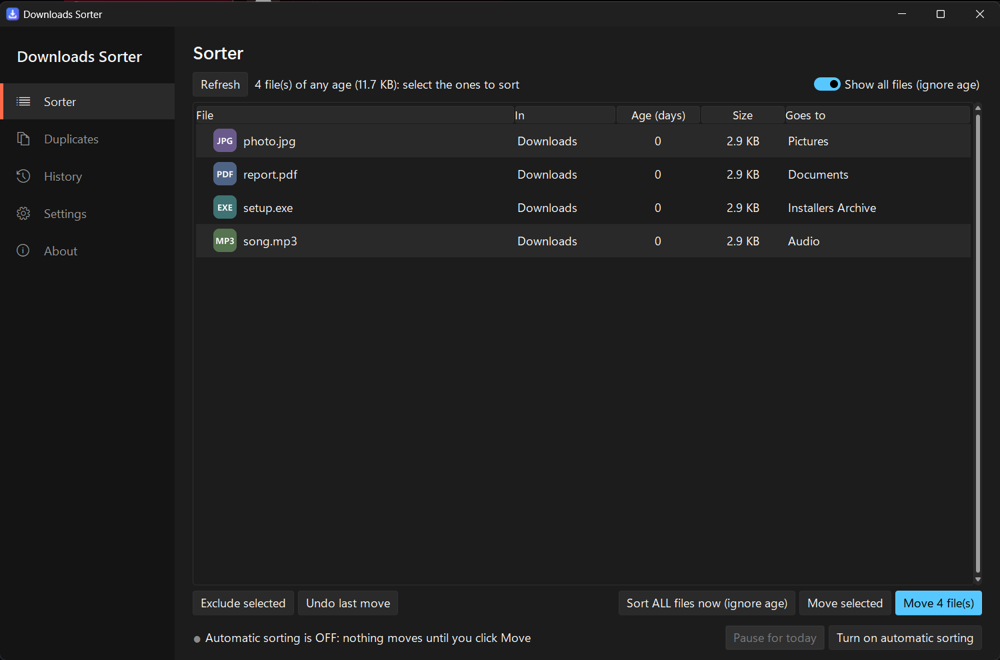

# Downloads Sorter

**English** | [العربية](#العربية)

A small Windows program that keeps your Downloads folder tidy. It moves files that have been sitting there for a while into category folders (Documents, Pictures, Videos…), either automatically in the background or only when you say so. Every change is logged and can be undone.



## Features

- **Sorts by age and type.** Files older than a set number of days (7 by default) move into category folders by file extension. Each category can have its own age.
- **Preview first.** See exactly which files will move and where before anything happens, and exclude the ones you want to keep.
- **Automatic mode.** Runs in the background with a tray icon, checks on a schedule, and starts when you sign in. After each run a report window lets you approve or undo what moved.
- **Full history with undo.** Every move and deletion is logged. Put back any files you choose; deleted files are restored from the Recycle Bin.
- **Duplicate finder.** Looks in the sorted folders or any folder you pick (with or without subfolders) and finds copies by identical content, exact name, name and size, size, or a *similar name*: messy song and video titles such as `Artist - Title (Official Music Video) 720p.mp4` and `Artist "Title" feat. X.mp4` are matched as the same file. Filter the results by extension, name or size, tick files one by one or with quick picks (all but the newest, the biggest in each group, copies inside a folder…), then choose each time whether they go to the Recycle Bin (undo from History) or are deleted for good. Identical-content copies are ticked for you; a warning appears before every copy of a file would go. The page remembers its settings and the window keeps its size.
- **Auto clean-up.** Optionally recycle old files in a category (for example installers after 90 days). Only files the program itself moved are touched.
- **Never-move list.** Protect files by name or pattern (`*.torrent`). Files you put back with Undo are not moved again automatically.
- **Several folders.** Sort Desktop or any other folder with the same rules.
- **English and Arabic.** The interface follows Windows' language, or you pick one in Settings.
- **Tray icon.** Always in the taskbar tray while the program is running, with quick actions.
- **Updates.** Checks this repository's releases, notifies you when a new version is out, and updates with one click (or automatically, if you turn that on).
- **Safe by design.** Unfinished downloads and shortcuts are skipped, nothing is ever overwritten, and deletions go to the Recycle Bin unless you choose to delete duplicates for good.

## Install

Download `DownloadsSorterSetup.exe` from the [Releases](../../releases) page and run it. It installs for your user account only and needs no administrator rights. The installer is not code-signed, so Windows SmartScreen may warn you: click **More info**, then **Run anyway**.

## Run from source

Requires Windows 10/11 and Python 3.10 or newer.

```
pip install -r requirements.txt
pythonw sort_gui.pyw
```

## Build the installer

Requires [Inno Setup 6](https://jrsoftware.org/isinfo.php) (`winget install JRSoftware.InnoSetup`).

```
pip install pyinstaller
python build.py
```

This produces `DownloadsSorterSetup.exe`, a standard Windows setup wizard in English and Arabic, next to the scripts.

## How it works

| File | Purpose |
|---|---|
| `sort_downloads.py` | The engine: rules, moving, history, undo, background loop and tray icon |
| `duplicates.py` | The duplicate finder: the five ways of matching files, including similar song and video names |
| `cleaner.py` | The cleaner: finds temporary files, browser caches, crash reports and other junk |
| `booster.py` | The booster: startup apps, memory-hungry programs and the power plan |
| `vault.py` | The vault: password-protected, encrypted storage for private files |
| `sort_gui.pyw` | The windows: control panel, report window, and the program's entry point |
| `theme.py` | Look and feel: dark theme, sidebar, colour tiles, display scaling |
| `installer.iss` | The setup wizard (Inno Setup script) |
| `build.py` | Packages the program with PyInstaller and compiles the setup wizard |
| `make_icon.py` | Draws the app icon |

Settings, the history log and the activity log are stored in `%APPDATA%\DownloadsSorter`.

## License

Released under the [MIT License](LICENSE): free to use, change and share.

The bundled fonts in `fonts/`, [DM Sans](https://github.com/googlefonts/dm-fonts) and [Manrope](https://github.com/googlefonts/manrope), are under the SIL Open Font License; their licence texts are next to them.

---

<div dir="rtl">

## العربية

[English](#downloads-sorter) | **العربية**

برنامج صغير لنظام ويندوز يحافظ على ترتيب مجلد التنزيلات. ينقل الملفات التي بقيت في المجلد لفترة إلى مجلدات مصنّفة (مستندات، صور، فيديو…)، إما تلقائيًا في الخلفية أو فقط عندما تطلب ذلك. كل تغيير يُسجَّل ويمكن التراجع عنه.

### المميزات

- **الفرز حسب العمر والنوع.** الملفات الأقدم من عدد محدد من الأيام (7 افتراضيًا) تُنقل إلى مجلدات التصنيف حسب امتداد الملف، ويمكن تحديد عمر مختلف لكل تصنيف.
- **المعاينة أولًا.** شاهد الملفات التي ستُنقل ووجهتها قبل أي تنفيذ، واستثنِ ما تريد إبقاءه.
- **الوضع التلقائي.** يعمل في الخلفية مع أيقونة بجانب الساعة، ويفحص المجلد وفق جدول زمني، ويبدأ مع تسجيل الدخول. بعد كل عملية تظهر نافذة تقرير للموافقة على ما نُقل أو التراجع عنه.
- **سجل كامل مع إمكانية التراجع.** كل عملية نقل أو حذف تُسجَّل. يمكنك إعادة أي ملفات تختارها، والملفات المحذوفة تُستعاد من سلة المحذوفات.
- **كاشف الملفات المكررة.** يبحث في المجلدات المرتّبة أو في أي مجلد تختاره (مع المجلدات الفرعية أو بدونها)، ويعثر على النسخ المكررة حسب المحتوى المتطابق، أو الاسم نفسه، أو الاسم والحجم، أو الحجم، أو *الاسم المتشابه*: عناوين الأغاني والفيديو الفوضوية مثل `Artist - Title (Official Music Video) 720p.mp4` و`Artist "Title" feat. X.mp4` تُعتبر الملف نفسه. صفِّ النتائج حسب الامتداد أو الاسم أو الحجم، وحدّد الملفات واحدًا واحدًا أو باختيارات سريعة (الكل ما عدا الأحدث، الأكبر في كل مجموعة، النسخ داخل مجلد…)، ثم اختر في كل مرة: إلى سلة المحذوفات (ويمكن التراجع من السجل) أو حذف نهائي. النسخ المتطابقة في المحتوى تُحدَّد تلقائيًا، ويظهر تحذير قبل حذف كل نسخ ملف ما. الصفحة تتذكر إعداداتها والنافذة تحتفظ بحجمها.
- **التنظيف التلقائي.** خيار لإرسال الملفات القديمة في تصنيف معيّن إلى سلة المحذوفات (مثل ملفات التثبيت بعد 90 يومًا). لا يمسّ إلا الملفات التي نقلها البرنامج نفسه.
- **قائمة «لا تنقل أبدًا».** احمِ ملفات معيّنة بالاسم أو بالنمط (مثل `*.torrent`). الملفات التي أعدتها بالتراجع لا تُنقل تلقائيًا مرة أخرى.
- **عدة مجلدات.** افرز سطح المكتب أو أي مجلد آخر بالقواعد نفسها.
- **العربية والإنجليزية.** الواجهة تتبع لغة ويندوز، أو تختار اللغة من الإعدادات.
- **أيقونة بجانب الساعة.** تظهر دائمًا ما دام البرنامج يعمل، مع إجراءات سريعة.
- **التحديثات.** يتحقق من إصدارات هذا المستودع، وينبّهك عند صدور نسخة جديدة، ويحدّث نفسه بضغطة واحدة (أو تلقائيًا إذا فعّلت ذلك).
- **آمن في تصميمه.** يتجاوز التنزيلات غير المكتملة والاختصارات، ولا يستبدل أي ملف موجود، والحذف يكون إلى سلة المحذوفات إلا إذا اخترت حذف الملفات المكررة نهائيًا.

### التثبيت

نزّل الملف `DownloadsSorterSetup.exe` من صفحة [الإصدارات](../../releases) وشغّله. يُثبَّت البرنامج لحساب المستخدم الحالي فقط ولا يحتاج إلى صلاحيات المسؤول. ملف التثبيت غير موقّع رقميًا، لذلك قد يعرض ويندوز تحذير SmartScreen: اضغط **More info** ثم **Run anyway**.

### التشغيل من الشيفرة المصدرية

يتطلب ويندوز 10 أو 11 وبايثون 3.10 أو أحدث.

</div>

```
pip install -r requirements.txt
pythonw sort_gui.pyw
```

<div dir="rtl">

### بناء ملف التثبيت

يتطلب [Inno Setup 6](https://jrsoftware.org/isinfo.php) (`winget install JRSoftware.InnoSetup`).

</div>

```
pip install pyinstaller
python build.py
```

<div dir="rtl">

ينتج عن ذلك الملف `DownloadsSorterSetup.exe`، وهو معالج تثبيت ويندوز قياسي بالعربية والإنجليزية، بجانب ملفات البرنامج.

### أين تُحفظ البيانات

الإعدادات وسجل التغييرات وسجل النشاط تُحفظ في المجلد `%APPDATA%\DownloadsSorter`.

### الترخيص

البرنامج منشور بموجب [رخصة MIT](LICENSE): يحق لك استخدامه وتعديله ومشاركته بحرية.

</div>
